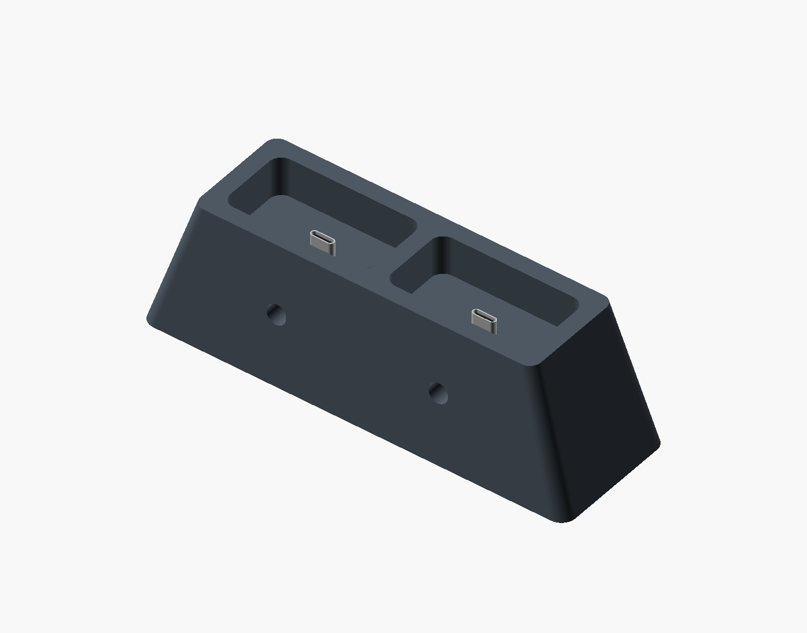
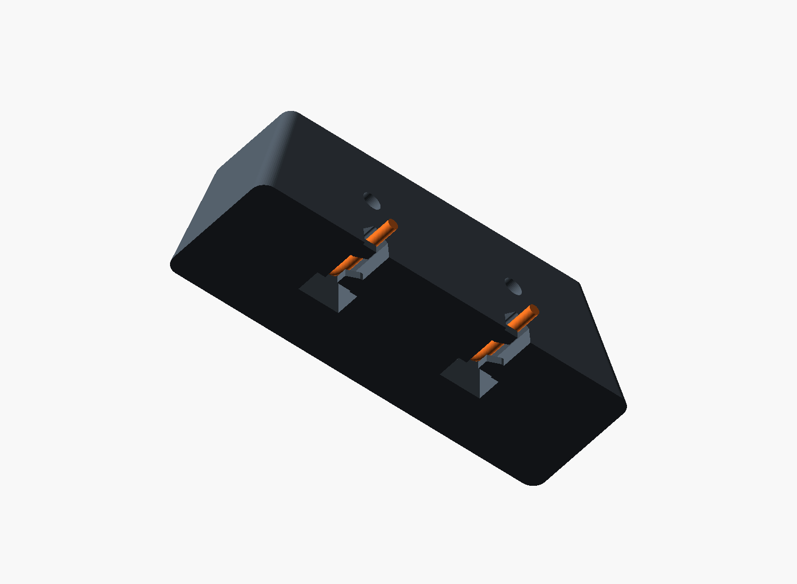

# Simple M5 charging dock

A rounded rectangular block with the convex hull of the M5's base subtracted, and
an actual USB-C cable plug rising through the middle of each pocket. Two bays
are the default, with opposed M3 screws retaining each plug. This revision
is for reviewing the shape before taking measurements. **Fit and charging are
unvalidated.**

Open [charging-dock.scad](../cad/charging-dock.scad) directly in OpenSCAD and press
F5/F6. Default `part="assembly"` shows the block and a silver reference USB plug.
Set `part="dock"` to export just the printed plastic, or `part="coupon"` for a
5 mm tall ring checking the pocket outline. `bays=2` is the default;
`bays=1` produces a single pocket. `show_device=true` adds transparent body
envelopes in F5 preview.

The pocket uses `hull()` around four vertical cylinders, giving a rounded
rectangular outline. Its fit profile, straight walls and flat floor are unchanged.
The exterior has rounded vertical corners and tapers inward from a wider flat
base to the original top dimensions. There are no separate
cradle rails, carrier, labels or bottom cover. A hole under each pocket
accepts a cable plug from below; a smaller opening lets its metal tip through.
The overmould shoulder meets the underside of the floor. An underside groove
routes the cable to the rear through a rounded pointed arch. Its 45-degree
shoulders close to a small rounded crown instead of a 10 mm flat ceiling.
Opposing front/rear screws clamp the overmould,
allowing smaller bodies to stay centered in the larger socket. The USB plugs,
screws and brass inserts are hardware illustrations, not printed geometry.

## Cable hold-down tabs

Each bay has **two integral tabs on opposite sides of the rear cable channel**.
One sits near the rounded 90-degree bend and the other near the exit, keeping the cable above the
dock's bottom face instead of letting springback push it against the table.

The near tab projects from the left wall and the far tab from the right wall.
The tabs are **3 mm thick**, with **4 mm wide tips and 6 mm wide flared roots**.
They are **14.11 mm apart center-to-center**, with a **10.11 mm gap between their
tip edges**. The roots flare into the space between the tabs, spreading the
attachment into the wall while leaving 6.11 mm between the wider roots.
Tuck the cable under one
tab, then the other, using the opposite-side loading gaps. Each loading gap is
4.5 mm for the assumed 4 mm cable. Both ledges extend 0.5 mm past the center so
the cable is captured beneath them from opposite sides; no sharp fold is intended.
They are flush with the bottom of the block and are included in the dock STL.

The reference cable uses a **10 mm centerline bend radius**, with its lowest
horizontal surface 3.4 mm above the bottom (0.4 mm above the 3 mm tabs). Measure the real cable/boot and
increase the bend radius and floor height if needed. Guards reject inadequate
bend room or a channel too narrow to load beside the tabs. Test that the cable
stays captured under springback and that the dock sits flat before relying on it.

## Plug retention

Each bay uses **two M3 screws, 10 mm maximum under-head length**, and **two M3
heat-set inserts, 6 mm long by default**. Set `insert_l=8` for an 8 mm long insert;
this leaves less screw travel, so the parameter guards reject a plug the screw
cannot reach. The default 7 mm thick preview plug is just within the nominal
reach with 8 mm inserts; check the actual stack before choosing them.

The access bores recess the heads and bring the inserts closer to the overmould,
so the screws can remain short. Install the inserts from the front/rear through
these access bores, with the cable absent. Choose a heat-setting tip that fits
the recess and set the pilot diameter from the selected insert's specification.
The 4.4 mm pilot is an assumption, not a universal M3 insert size.

Load the cable from below, align its metal tip with the pocket opening, and tighten
both screws evenly on the insulated overmould. Flat/nylon tips or small protective
pads avoid a sharp point digging into it. Keep the plug centered while adjusting;
do not press against the metal shell or cable. Screw friction must resist downward
device insertion, and the plug's shoulder resists upward withdrawal. That grip
still needs a physical test.

## Dimensions to adjust

All dimensions are millimetres. X is left/right, +Y is rear, +Z is up.

| Parameter | Default | Meaning |
| --- | --- | --- |
| `device_w`, `device_d` | 51.6, 26.3 | M5 base width/depth |
| `corner_r` | 4 | Assumed base corner radius in plan view |
| `clearance` | 0.3 per side | Intended snug sliding fit; actual pocket 52.2 × 26.9 |
| `pocket_depth` | 14 | How far the device sits into the block; check side button clearance |
| `wall` | 6 | Block thickness around the pocket |
| `floor_z` | 34 | Device support plane; includes room for the cable bend |
| `outer_r`, `base_scale` | 4, 1.25 | Top exterior corner radius and bottom width/depth multiplier |
| `port_x`, `port_y` | 0, 0 | Port center relative to device center |
| `plug_w`, `plug_d`, `plug_body_h` | 12, 7, 16 | Assumed real cable's overmould dimensions |
| `socket_w`, `socket_d` | 16, 9 | Maximum nominal plug-body envelope; stays fixed for smaller cables |
| `plug_clearance` | 0.2 per side | Clearance around the plug and metal opening |
| `metal_w`, `metal_d`, `metal_h` | 8.4, 2.6, 6.5 | Assumed exposed plug shell dimensions |
| `plug_protrusion` | 5 | Metal tip above pocket floor; actual required engagement remains unknown |
| `cable_slot_w`, `cable_slot_h`, `cable_roof_r` | 10, 12, 0.8 | Groove width, nominal pointed-arch height and crown radius; rounded peak is 11.67 mm high |
| `cable_d`, `cable_bend_r` | 4, 10 | Cable diameter and centerline bend radius |
| `tab_t`, `tab_w`, `tab_root_flare` | 3, 4, 2 | Tab thickness, tip width along the cable, and added root width; two per bay |
| `tab_overlap`, `tab_clearance` | 0.5, 0.4 | Tip reach beyond channel center and gap above tabs |
| `insert_l`, `insert_hole_d` | 6, 4.4 | Heat-set insert length (6 or 8) and pilot diameter |
| `screw_l`, `screw_clear` | 10, 3.4 | M3 screw under-head length (at most 10) and through-hole diameter |
| `insert_web`, `access_d` | 0.8, 7 | Plastic before the cavity and recessed tool/head access diameter |

Default two-bay top: **122.4 × 38.9 mm**; bottom footprint: **153 × 48.625 mm**;
height: **48 mm**. The bottom is 25% wider and deeper than the top. The one-bay
top is **64.2 × 38.9 mm**, with an **80.25 × 48.625 mm** bottom, also 48 mm tall.
The top outside corner radius is 4 mm, growing to 5 mm at the base. The device
pocket remains 52.2 × 26.9 mm with the same radius, depth and USB position.

The exterior slopes inward by about 17.7 degrees from vertical across the two-bay
width, and 5.8 degrees across the depth. Each layer stays inside the previous
layer, with a flat bed face and no curved underside that would need support.
The body rests on the pocket floor. Match plug height to the measured socket so
the connector does not become the device's support.

When the shape looks right, measure the lower 14 mm of the actual body: width,
depth, taper, corner and bottom-edge rounding, side button protrusions, and back
clip clearance. Then measure port center, recess and insertion direction, chosen
plug envelope, seated engagement, and cable bend/exit clearance. The current hull
is an approximation; measured taper or bottom rounding can replace it later.

## Source evidence and checks

The [Elecrow manual](https://www.elecrow.com/download/product/ILM13205D/ThinkNode_M5_User_Manual.pdf)
provides the 82 × 51.6 × 26.3 mm size (printed page 4) and shows a bottom-facing
Type-C port (printed page 1). It does not dimension the base profile, port location
or cable plug. Accessory inclusion in the size is unspecified. The
[official wiki](https://www.elecrow.com/wiki/ThinkNode_M5_Meshtastic_LoRa_Signal_Transceiver_ESP32-S3.html)
is the companion reference. All other dimensions above are prototype assumptions.

Run `python3 cad/build.py` to regenerate the [STLs](../cad/exports/) and previews.
It uses installed OpenSCAD and standard-library Python. Each dock/coupon mesh is
checked for closed edges, consistent winding, a single connected solid, positive
volume and Z=0 print orientation. Parameter guards and an empty-intersection
check between the curved reference cable and dock/tabs are also checked. Results are
in [validation.json](../cad/exports/validation.json).

Print upright with the flat block bottom on the bed: the flared exterior and
rounded vertical corners have no external overhangs, and both tabs start at Z=0
and connect to the channel wall. The cable-exit roof uses 45-degree shoulders,
with only about 1.13 mm between its crown tangent points. The small rounded crown,
plug opening and screw bores still need bridging review; inspect these in the slicer and test the printer's
bridging before calling the whole print support-free. Keep the cable space above
the tabs clear of trapped support material. The fit coupon is unchanged.

Physical measurements, clamp grip/insert fit, printing/supports, button clearance,
cable bend/strain relief, stability and charging tests are deferred until the
shape is approved. No charging electronics are included; a real cable would feed
the M5's built-in charger.
