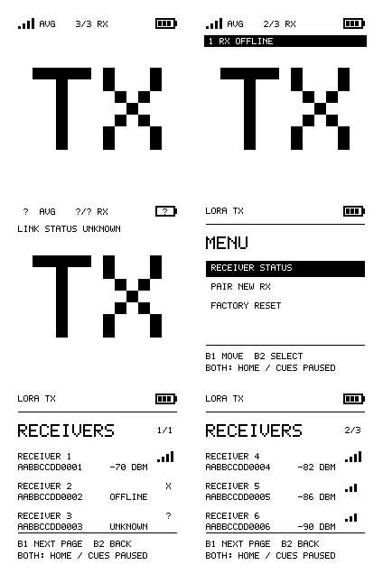
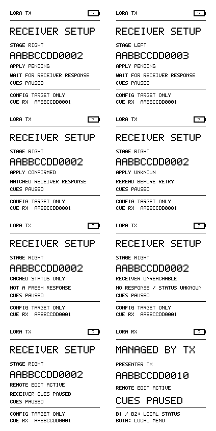
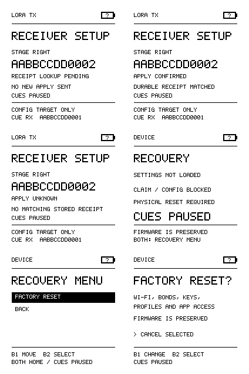

# Minimal device interface

The TX home is deliberately simple: a large **TX**, coarse battery, **AVG** radio
signal bars, and **connected/paired RX** count. It has no profile, action labels,
click counter, GPS, charging inference or battery percentage. A missing-receiver
warning is independent of the average: two strong receivers must not hide a third
unreachable receiver. [Open the review](../device-preview.html).



These are exact 200×200 firmware framebuffer renders with demonstration values,
not hardware measurements. Rows show all fresh / partial offline, unknown / menu,
and mixed receiver status / a later page. The browser labels its data as fixtures.
**Minimal TX** is implemented; **Count first** and **Larger count** are review
variations using the same bitmap pixels. Earlier action-first proposals remain
[archived](../designs/device-interface-proposals.html) and do not describe this UI.

## Signal and count semantics

Core supplies configured receiver membership and `radio_health::Observation` data
through `Snapshot.receivers[8]`. `receiverRosterKnown` means the list came from
committed settings. `linkMonitoringAvailable` means the radio monitor is available.
No UI timer, cue send, cached acknowledgement or unauthenticated RSSI can create a
connected receiver. Defaults are unknown.

A receiver counts as connected only if it is paired, has a nonempty unique ID,
and core marks it **Connected and fresh**. Unpaired slots, duplicate IDs and stale
Connected samples are excluded. Core only refreshes observations on accepted
fresh authenticated radio traffic/probe responses. `radio_health.h` owns its
elapsed-time policy and rollover-safe checks. Probe spacing depends on actual
packet airtime; freshness allows a complete round across paired receivers.
An explicit missed probe or expired observation is Offline; an initial receiver
without a response or completed probe is Unknown.

Connected means recently confirmed by authenticated radio traffic within that
window. It is not a continuous socket, a guarantee that the next cue arrives,
or proof of application effect. Offline means not recently confirmed; it does
not prove power is off. Busy radio management or interference can also prevent a
fresh response. Actual freshness/range and probe timing require physical tests.

**AVG** is the integer arithmetic mean of RSSI dBm measured at TX from fresh,
connected paired receivers that have a valid signal sample. The renderer accepts
reported RSSI from −160 through 0 dBm, excluding missing/invalid values. It maps
the mean into four coarse bands: ≤−115, ≤−100, ≤−85, and >−85 dBm. These are display
bands, not a calibrated distance, delivery probability or range estimate. A fresh
receiver with unknown RSSI can count as connected while contributing no average.
No eligible sample shows `?`, not zero signal or a fabricated measurement.

The home shows `?/? RX` when membership is unknown, `?/N RX` when monitoring is
unavailable, and `0/0 RX` only for a known empty pairing list. Missing receivers
produce a separate inverted **N RX OFFLINE**, **N RX UNKNOWN**, or **N RX MISSING**
line. Thus an average of four bars can coexist with `2/3 RX` and `1 RX OFFLINE`.
The battery symbol is unknown/low/medium/high from core voltage bands; these bands
still need physical calibration. No charging or remaining-runtime claim is made.

## Two buttons and the three-item TX menu

B1 is GPIO21 and B2 GPIO14, active low. At TX home, a debounced release still
requests Previous or Next, with no held repeat. The paper stays quiet: it does
not redraw a last-action message after each cue. A chord opens Menu only after
both buttons debounce and are released; raw overlap suppresses individual cues.
Buttons held at startup must first be released.

The TX menu contains exactly:

1. **Receiver status**
2. **Pair new RX**
3. **Factory reset**

B1 moves, B2 selects, Both returns home. Menus pause cues. Receiver status shows
three paired receivers per page: name, full ID and fresh RSSI, **Offline** or
**Unknown**. B1 advances pages, B2 returns to Menu, Both returns home. Invalid or
stale samples never appear as current RSSI. There are no routine profile, device,
LAN, route, account or firmware-update menu entries.

Pair new RX opens the physically authorized native BLE setup window. The app
handles adding a receiver and can manage existing receivers during that window;
opening it alone does not add a receiver or change cue routing. Initial claim and
pairing keep their required actual device identity/passkey screens. Either button
requests setup exit, while output remains paused until the service actually exits.
Native BLE is sufficient; browser USB flashing remains a separate required path.

RX buttons never generate cues. Its local menu retains **App setup**, **Factory
reset**, **Back** for initial pairing and physical recovery. During a remote edit
it displays **Managed by TX / Cues paused** with the authenticated controller ID;
Both still opens that local recovery path. Repeated status snapshots do not eject
the user from reset confirmation.

## Deliberate reset and exceptional recovery

Factory reset starts on **Cancel**. B1 selects Erase, B2 arms it, then both must
remain continuously held for three seconds after debounce. Early raw release,
a short chord, an individual button or leaving confirmation cancels without
leaking a cue. The UI emits one reset request and never claims a successful wipe
merely because the hold completed. Core owns persistence, bond removal and restart.

`ConfigStatus.recoveryRequired` maps to `Snapshot.recoveryRequired`. Unsupported
or damaged settings show **Recovery / Claim/config blocked**, pause cues, and
expose only **Factory reset / Back** through Both. App authorization cannot bypass
this. The guarded reset preserves firmware while clearing local settings,
credentials, profiles, controller keys and bonds. A local reset cannot delete an
offline cloud record; no account service is required or implemented.

Firmware updates start from the local authorized BLE app: open physical setup,
connect, then choose **Open update screen**. The clicker still requires physical
**B1 Check** and **B1 Install**. The app requests the screen only; it cannot check,
download or write firmware, and remote LoRa administration cannot open it. Busy
updates suppress ordinary buttons. The Tx menu remains exactly the three items
above. Browser USB installation and recovery remain available.

## Remote configuration and durable results

Administrator selection stays separate from `peers[activePeer]` cue routing.
Exceptional remote setup screens show the full selected receiver identity and
friendly name, plus a separate Cue RX footer. Changing the admin target never
broadcasts a cue, changes cue destination, or applies to every receiver.



Pending means no definitive receiver response. Apply confirmed requires a matching
authenticated successful Apply response. Rejected, unreachable, cached and unknown
states remain distinct. A missing Apply reply is unknown even if the receiver
committed; it is never automatically retried.



Protocol-v2 `result {transactionId}` maps to `RemoteOperation::Result`. Core sets
`remote.resultApplied` only when a matching authenticated reply contains
`result.state == "applied"`. `ok:true` with `state:"unknown"` still shows **Apply
unknown / No matching stored receipt**. A missing, rejected or cached lookup
cannot confirm Apply. The pending screen says **No new Apply sent**. Bounded
receipt history can be evicted; absence never proves that nothing committed.

The service uses 120 seconds without fresh authenticated progress for abandoned
remote-edit recovery. Duplicates/replay must not renew it; 3600 seconds is the
absolute transfer ceiling, not an hour-long disconnect grace period. UI follows
actual service state and owns no duplicate timeout or animated estimate. Physical
reset remains available. Receipt persistence, authority, encryption, correlation,
lease cleanup and final combined acceptance belong to config/radio integration.

## Boundary, rendering and evidence

`firmware/include/device_ui.h` is the portable presentation boundary. Core copies
committed membership and actual measurements, supplies pause/setup/recovery state,
consumes actions, and honors `cuesPaused()` for local and incoming cues. UI owns no
BLE, radio lifecycle, settings cache or secrets. The authoritative settings model
remains [config.schema.json](../contracts/config.schema.json).

Core maps TX `ConfigStatus.remoteDeviceId` to the admin identity; RX uses its
authenticated controller identity. `remotePending` maps to Pending, RX remote
editing maps to `Setup::RemoteEditing`, and Result requires its separate applied
flag. `cueReceiverId` comes only from committed cue selection. Core's current
`updateSnapshot()` populates receiver rows from its peer observations; no measured
signal is inferred from the review fixtures.

The original bitmap font is 5×7 in a 6×8 cell, uppercase ASCII with explicit
ellipsis/`?` fallback. TX uses ×13 scaling; its letters occupy 143×91 pixels.
Renderer output is 5,000 row-major bytes, MSB first, 1 = black. Actual small-text
readability, orientation and optics remain physical acceptance tests.

The independent FreeRTOS display task has a length-one overwrite queue, coalesces
the latest frame, skips identical frames and starts full refreshes at least 2.5 s
apart. The reference full refresh takes approximately 2 s. Input/radio do not wait
for it. Display HSPI uses SCK38, MOSI45, CS39, DC40, reset41, busy42, independently
of the radio. Allocation failure returns false; a retained paper image cannot
prove power or readiness.

Rebuild/check from the repository root:

```sh
python3 scripts/build-device-preview.py
python3 scripts/build-device-preview.py --check
c++ -std=c++17 -Wall -Wextra -Werror -fsanitize=undefined -Ifirmware/include \
  firmware/src/device_ui.cpp firmware/tests/ui/device_ui_test.cpp \
  -o /tmp/uberclicker-ui-test
/tmp/uberclicker-ui-test
```

The standard-library script compiles production UI assertions, generates 69 PBM/PNG
frames and review sheets, embeds the exact pixels into `designs/device-interface.html`
and synchronizes `device-preview.html`. It removes obsolete generated PNG/PBM files.
Keep code, authored fragment and generated preview together. Alternative header
layouts are review-only; the first variant matches firmware.

Tests cover minimal menu/navigation, paging, paired-only fresh counts/RSSI mean,
unpaired/duplicate/stale/invalid exclusion, strong average with a missing peer,
unchanged home after a cue, RX no-cue, button debounce/chord/no-repeat/startup-held,
reset cancellation/hold/rollover, pause transitions, durable receipt semantics,
remote target isolation and physical recovery. A mocked FreeRTOS/SPI/panel test
executes the production display task to check coalescing, cadence, identical-frame
skipping and allocation failures. UBSan passes; the host ASan runtime previously
stalled before test entry, so no ASan coverage is claimed.

[Hardware acceptance](hardware-validation.md) remains pending. UI preview/build
success does not validate RF freshness, RSSI calibration, BLE behavior or flashing.
